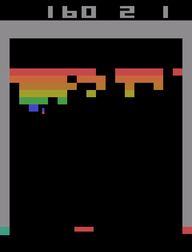
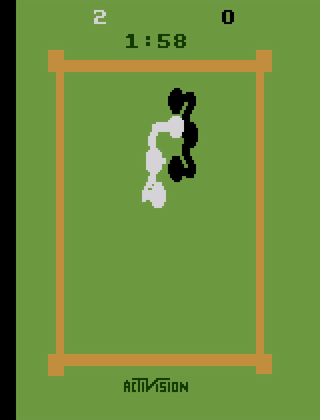
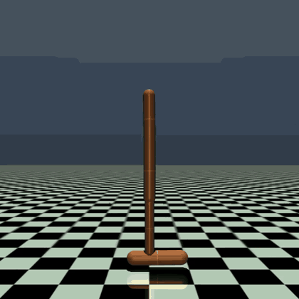
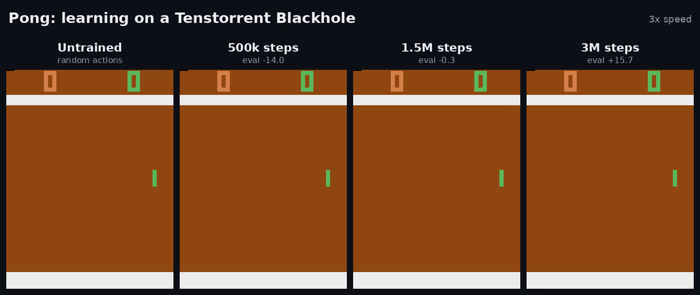
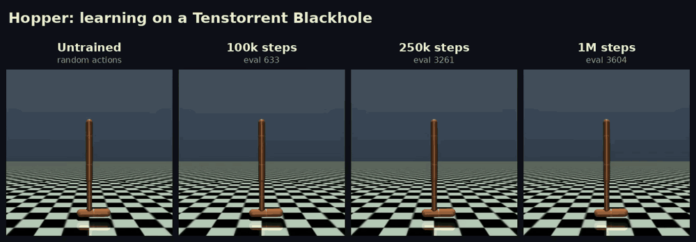
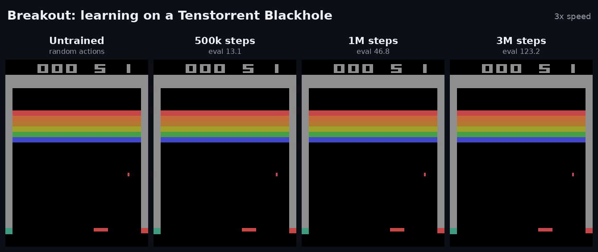
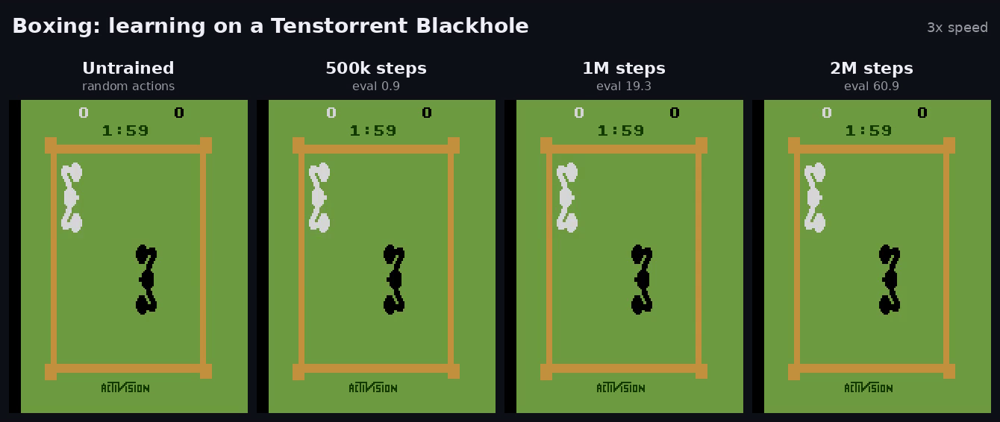

# tt-rl

[](https://github.com/scaleresearch/tt-rl/actions/workflows/ci.yml)
[](LICENSE)

Reinforcement learning on Tenstorrent hardware, built directly on
[TT-NN](https://github.com/tenstorrent/tt-metal). Networks, gradients, the Adam
step and the device trace all run on the chip through `ttnn`. Environments
and replay buffers stay on the host.

<table>
  <tr>
    <td align="center"><br>Pong, DQN</td>
    <td align="center"><br>Breakout, DQN</td>
    <td align="center"><br>Boxing, DQN</td>
    <td align="center"><br>Hopper, SAC</td>
  </tr>
</table>

- **Algorithms:** DQN (double, n-step, prioritized replay), PPO (GAE, clipping,
  optional GRU memory) and SAC (twin critics, learned temperature).
- **Environments:** Atari pixels, MuJoCo state vectors, and any environment you
  write against a small protocol.
- **Single or multiple chips:** a run trains on one chip, or data-parallel
  across several with one replica per chip.
- **Deploy anywhere:** export a trained policy to numpy or ONNX and run it on
  any CPU.

## Results

Measured on one Blackhole chip. Atari scores are the mean over 30 evaluation
episodes with sticky actions (0.25), which is harder than the
`NoFrameskip-v4` setting most published numbers use. A step is one agent
action, four Atari frames. Each score is the best evaluation of its run.

| Task | Algorithm | Steps | Score | Weights |
|---|---|---|---|---|
| Pong | DQN | 10M | 17.8 | [ttrl-dqn-pong](https://huggingface.co/scaleresearch/ttrl-dqn-pong) |
| Breakout | DQN | 10M | 144.8 | [ttrl-dqn-breakout](https://huggingface.co/scaleresearch/ttrl-dqn-breakout) |
| Boxing | DQN | 10M | 91.0 | [ttrl-dqn-boxing](https://huggingface.co/scaleresearch/ttrl-dqn-boxing) |
| Hopper-v5 | SAC | 1M | 3604 | [ttrl-sac-hopper](https://huggingface.co/scaleresearch/ttrl-sac-hopper) |

Each config in `configs/` records how it was measured in its docstring. The
trained policies are on Hugging Face as ONNX and numpy weights, with a
`play.py` that runs them on CPU.

### Learning

From an untrained agent to the final one, at fixed checkpoints of the same
run (Atari clips play at 3x speed):





<details>
<summary>Breakout and Boxing</summary>





</details>

## Requirements

- Linux and Python 3.12. `ttnn` 0.80 ships wheels for 3.10 and 3.12, and
  3.10 is dropped because current Pillow and filelock no longer support it.
- A Tenstorrent Blackhole chip with its driver and firmware installed.
  Developed on a TT-QuietBox with four Blackhole chips.

## Install

ttrl installs from source for now. A PyPI release as `tt-rl` is on its way,
after which `pip install tt-rl` will be enough.

```bash
git clone https://github.com/scaleresearch/tt-rl && cd tt-rl
pip install -e '.[atari]'     # Atari
pip install -e '.[mujoco]'    # MuJoCo
pip install -e '.[dev]'       # both, plus the test suite's dependencies
```

`ttnn` installs from PyPI as a dependency. Then check the machine:

```bash
ttrl doctor
```

It reports versions, which chips exist and who holds each one, and opens a
free chip to confirm a trace captures and replays.

## Train

A run is a Python config. Arguments after the path override any field by
its dotted name:

```bash
ttrl train configs/pong_dqn.py device.chip=0
ttrl train configs/pong_dqn.py total_frames=3000 algo_cfg.learning_starts=500 log_dir=runs/smoke
```

The same from Python:

```python
import ttrl

config = ttrl.load_config("configs/pong_dqn.py", overrides=["device.chip=0"])
result = ttrl.run(config)
```

A run writes metrics, checkpoints and `checkpoint-best.npz` to its
`log_dir`. `ttrl train --resume best <config>` continues from the best one;
DQN and SAC runs also need `checkpoint_replay=True` so the replay buffer is
saved with them.
`examples/atari-dqn` and `examples/mujoco-sac` are standalone projects that
use ttrl as a library.

A chip is exclusive to one process. `device.chip=N` names a physical chip,
the `N` in `/dev/tenstorrent/N`; leave it unset to take the lowest free one.

### Multiple chips

`device.chips` trains one replica per chip. Each replica steps its own
environments and runs its own updates, and every `device.sync_every` updates
(50 by default) the replicas average their parameters, so they stay one model.

```bash
ttrl train configs/pong_ppo.py device.chips=4          # any 4 chips
ttrl train configs/pong_ppo.py device.chips=all        # every chip on the machine
ttrl train configs/pong_ppo.py 'device.chips=[0,1]'    # these physical chips
```

```python
config = ttrl.load_config("configs/pong_ppo.py", overrides=["device.chips=4"])
ttrl.run(config)
```

N replicas collect N times the experience per update round, so a multi-chip
run is a different recipe from its single-chip config, and learning rates or
batch sizes may need retuning. PPO, which already runs many environments at
once, is the natural fit.

## Deploy without a chip

```python
import ttrl

artifact = ttrl.export_policy("runs/pong/checkpoint-best.npz", "pong.policy.npz")
ttrl.export_onnx(artifact, "pong.onnx")      # needs the [onnx] extra

policy = ttrl.load_policy(artifact)          # numpy only
action = policy(obs)                         # obs: one raw observation
```

The ONNX graph has one input, `obs`, and two outputs, `action` and `head`
(the Q-values or action distribution). It runs with `onnxruntime`, and the
Atari DQN graph also compiles unchanged with Tenstorrent's TT-Forge-ONNX.

## Your own environment

An environment is any object with `obs_spec`, `action_spec`, `episode_bound`,
`reset`, `step` and `close`. Nothing needs subclassing:

```python
import numpy as np
import ttrl
from ttrl.envs import check_env
from ttrl.envs.registry import register
from ttrl.envs.wrappers import RecordEpisodeStatistics


class Slider:
    """Move a point to the origin. Reward is the step's reduction in |x|."""

    obs_spec = ttrl.ObsSpec.vector(2)
    action_spec = ttrl.ActionSpec.discrete(3)
    episode_bound = 64

    def reset(self, *, seed=None):
        self.rng = np.random.default_rng(seed)
        self.x, self.t = float(self.rng.uniform(-1.0, 1.0)), 0
        return self._obs(), {}

    def _obs(self):
        return np.array([self.x, self.t / self.episode_bound], dtype=np.float32)

    def step(self, action):
        before = abs(self.x)
        self.x = float(np.clip(self.x + (int(action) - 1) * 0.05, -1.0, 1.0))
        self.t += 1
        return self._obs(), before - abs(self.x), False, self.t >= self.episode_bound, {}

    def close(self):
        pass


register("slider", lambda **kw: RecordEpisodeStatistics(Slider(**kw)))
check_env(RecordEpisodeStatistics(Slider()))

config = ttrl.TrainConfig(
    algo="dqn",
    total_frames=4_000,
    eval_interval=4_000,
    log_dir="runs/slider",
    env=ttrl.EnvConfig(name="slider", n_envs=1),
    algo_cfg=ttrl.DQNConfig(batch_size=64, learning_starts=500, buffer_capacity=4_000),
)
ttrl.run(config)
```

`check_env` raises on the first contract violation with a message saying what
was expected. `RecordEpisodeStatistics` is required: evaluation reads each
episode's score from it.

## Tests

```bash
pytest                 # host suite, no chip needed
pytest -m tt           # hardware suite, needs a chip
```

## License

MIT
